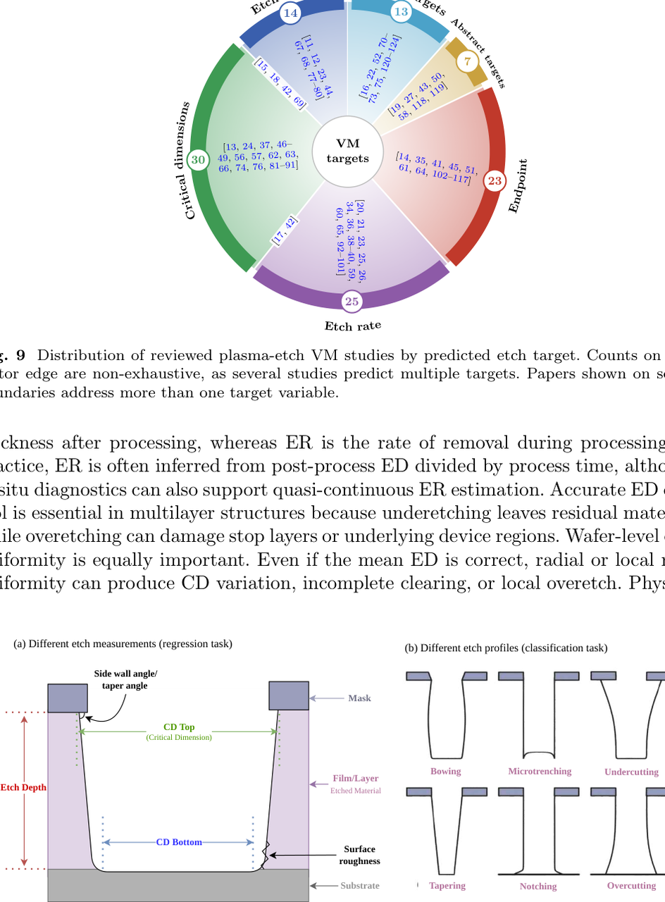

# dsh-pdf-reader

**English** | [中文](README.zh.md)

A DeepSeek Harness tool plugin that adds `pdf_read`: it reads a PDF in **reading order** as interleaved content — a run of text, the figure that belongs there, the text inside that figure, its caption, then the text that follows. Figures stay where they appear instead of piling up at the end.



## Install

```sh
dsh plugin --profile <profile> add git+https://github.com/xincy22/dsh-pdf-reader
```

Restart DSH and the tool is available. **No Python, no system programs, no setup.** The PDF engine is the official WebAssembly build of [MuPDF](https://mupdf.com) (the `mupdf` npm package). The package manager installs it with the plugin and it runs in DSH's own Node, the same way on macOS, Windows and Linux.

## What it does

- **Two-column papers are read column by column**; titles, figures and footers that span both columns are their own rows.
- **Figures in place**: vector figures (diagrams, flowcharts, charts) and raster images are found, cropped to PNG and attached. Side-by-side (a)/(b) panels that share one caption become one figure.
- **Text inside figures** comes back as `[Text inside p3-fig1]` right after the image, kept out of the prose.
- **Captions** starting with `Figure 1`, `Fig.`, `Table 3`, `图 2` and similar follow their figure.
- **Headings** are marked with `#` from font size and weight; reading page 1 also returns the document outline.
- **Scanned pages** without a text layer come back as one full-page image.
- **Encrypted PDFs** open with `password`.
- **Text-only models** automatically get text only, still with figure text and captions.

## Tool

| Argument | Type | Meaning |
| --- | --- | --- |
| `path` | string, required | PDF path; relative paths resolve against the working directory |
| `pages` | string | `"5"`, `"5,16"`, `"5-9"`, `"12-"` (to the end). Default: first 5 pages; at most 20 per call |
| `withImages` | boolean | Default true; false turns figures into markers and spends no image tokens |
| `dpi` | integer | Figure resolution, 72–300, default 150; raise it for small print in charts |
| `password` | string | Password of an encrypted PDF |

Returns `blocks` (reading-order content with figures as attachment references), `text` (plain text with figure markers), `pageCount`, `pagesRead`, `figureCount`, `imageCount`.

Optional profile config (override the `pdf-reader` row in `cordis.patch.yml`): `dpi` (default resolution) and `maxImages` (images per call, default 20, also bounded by DSH's attachment limits).

## How it works

| File | Role |
| --- | --- |
| `src/index.js` | Registers the tool; reads files through DSH's `fs` service so sandbox and working-directory rules apply; attaches images within the attachment limits |
| `src/reader.js`, `src/worker.js` | MuPDF runs on a worker thread so DSH stays responsive; cancellation or a timeout terminates the thread and the next call starts a fresh one |
| `src/engine.js` | Collects text blocks and drawing operations through MuPDF and renders figure regions to PNG |
| `src/layout.js` | Pure geometry: figure clustering, caption assignment, sub-figure merging, XY-cut reading order, headings and page numbers |
| `src/content.js` | Builds the tool value and the model-facing content blocks |

Reading three pages of a two-column paper takes about 0.1–0.2 s.

## Known limits

- Figure regions come from clustering drawing geometry, not from a layout model. Small icons next to text without a caption can be missed or picked up.
- Text inside figures comes from the PDF text layer; there is no OCR. Scanned pages are returned as images for the model to look at.
- Curved or rotated labels can come out of order; cite chart numbers from the image.
- Complex tables come out block by block, not as Markdown tables.

## Development

```sh
pnpm install
node --test "test/*.test.js"              # unit and integration tests; PDFs are generated in the tests
node dev/try.mjs paper.pdf 1-3 /tmp/out   # print the output for a PDF and save the cropped figures
```

`dev/probe/`, `dev/figures/` and the other `dev/` folders record the earlier PyMuPDF line of work and are not published.

## License

The plugin code is MIT, see [LICENSE](LICENSE). Its runtime dependency MuPDF is AGPL-3.0, see [THIRD_PARTY_NOTICES.md](THIRD_PARTY_NOTICES.md).
