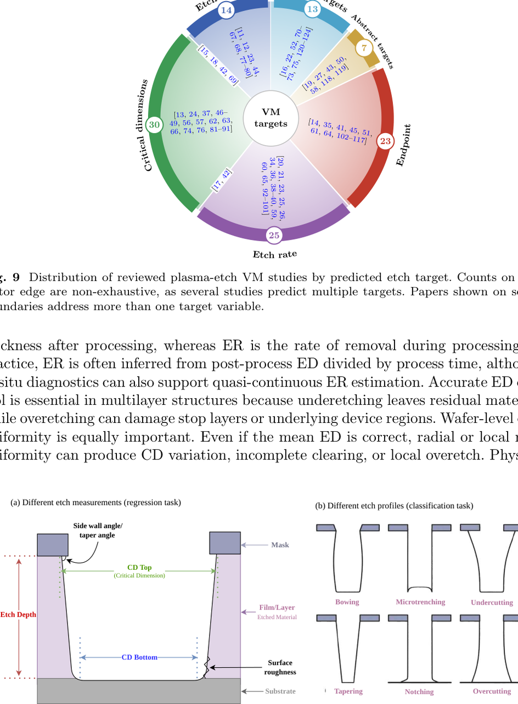

# dsh-pdf-reader

[English](README.md) | **中文**

给 DeepSeek Harness 加一个 `pdf_read` 工具：把 PDF 按**阅读顺序**读成图文交替的内容 —— 一段字、一张图、图里的文字、图注、下一段正文。图落在它原本所在的位置，不堆在末尾。



## 安装

```sh
dsh plugin --profile <profile> add git+https://github.com/xincy22/dsh-pdf-reader
```

装完重启 DSH 即可使用。**不需要 Python，也不需要任何系统程序或手动配置。** PDF 引擎是 [MuPDF](https://mupdf.com) 的官方 WebAssembly 版（npm 包 `mupdf`），安装插件时由包管理器一并装好，在 DSH 自带的 Node 里运行，macOS、Windows、Linux 行为一致。

## 它做什么

- **双栏论文按栏读**：先左栏再右栏；横跨两栏的标题、图、页脚单独成行。
- **图在原位**：矢量图（流程图、示意图、图表）和位图都能找到，按图区裁成 PNG 交给模型；并排的 (a)(b) 子图共用一个图注时合成一张。
- **图内文字单独给出**：图里的标注、坐标轴文字作为 `[Text inside p3-fig1]` 紧跟在图后，不混进正文。
- **图注挂在图后**：识别 `Figure 1`、`图 2`、`Table 3` 等开头的图注。
- **标题与目录**：按字号和粗体标出 `#` 标题；读第 1 页时附带文档书签目录。
- **扫描页**：没有文字层的页面整页作为图片返回。
- **加密 PDF**：传 `password` 即可打开。
- **不支持图片的模型**：自动只返回文字，图内文字和图注照常给出。

## 工具参数

| 参数 | 类型 | 说明 |
| --- | --- | --- |
| `path` | string，必填 | PDF 路径；相对路径按当前工作目录解析 |
| `pages` | string | `"5"`、`"5,16"`、`"5-9"`、`"12-"`（到末页）。省略读前 5 页；每次最多 20 页 |
| `withImages` | boolean | 默认 true；false 时图换成位置标记，不消耗图像 token |
| `dpi` | integer | 图的分辨率，72–300，默认 150；看图表小字时调高 |
| `password` | string | 加密 PDF 的密码 |

返回值：`blocks`（图文交替的顺序内容，图是附件引用）、`text`（纯文本，图处留标记）、`pageCount`、`pagesRead`、`figureCount`、`imageCount`。

可选的 profile 配置（`cordis.patch.yml` 里按 id `pdf-reader` 覆盖）：`dpi`（默认分辨率）、`maxImages`（每次最多附几张图，默认 20，同时受 DSH 附件上限约束）。

## 实现

| 文件 | 作用 |
| --- | --- |
| `src/index.js` | 注册工具；经 DSH 的 `fs` 服务读文件，沙箱与相对路径规则照常生效；按附件服务的上限提交图片 |
| `src/reader.js` / `src/worker.js` | MuPDF 跑在 worker 线程里，不阻塞 DSH；取消或超时直接结束线程，下次调用重建 |
| `src/engine.js` | 调 MuPDF 取文字块、绘图对象，按图区渲染 PNG |
| `src/layout.js` | 纯几何：图区聚类、图注归属、子图合并、XY-cut 阅读顺序、标题与页码 |
| `src/content.js` | 组装成工具结果和给模型的内容块 |

一次读 3 页双栏论文约 0.1–0.2 秒。

## 已知限制

- 图区靠绘图对象的几何聚类判断，不是版面模型。紧贴正文、没有图注的小图标可能被当成图或漏掉。
- 图内文字来自 PDF 文字层，不做 OCR；扫描页只返回整页图片，由模型自己看。
- 弧形或旋转的标签文字可能字序错乱，引用图表数据时以图为准。
- 复杂表格按文字块逐格输出，不还原成 Markdown 表格。

## 开发

```sh
pnpm install
node --test "test/*.test.js"          # 单元与集成测试，PDF 在测试里现场生成
node dev/try.mjs paper.pdf 1-3 /tmp/out   # 看某份 PDF 的输出和裁出的图
```

`dev/` 里的 `probe/`、`figures/` 等是早期 PyMuPDF 路线的实验记录，不随插件发布。

## 许可

插件代码以 MIT 发布，见 [LICENSE](LICENSE)。运行时依赖的 MuPDF 为 AGPL-3.0，见 [THIRD_PARTY_NOTICES.md](THIRD_PARTY_NOTICES.md)。
